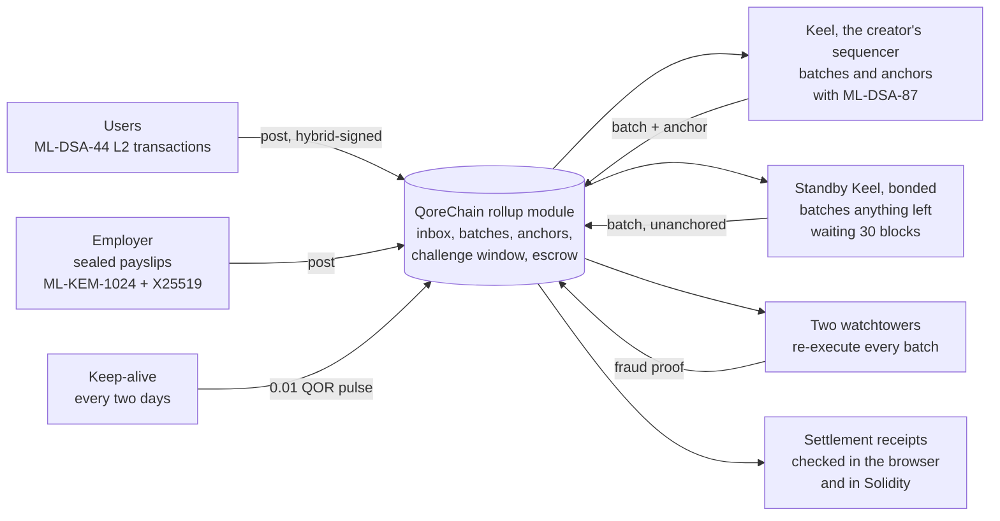

# Vigil


**A payments rollup built to survive Q-Day, and proven on chain.** Vigil runs `vigil-pay-1`, a qledger-v1 optimistic rollup on the QoreChain testnet (`qorechain-diana`):
- Users sign with ML-DSA-44.
- Every batch from the sequencer is anchored with an ML-DSA-87 signature.
- Two watchtowers re-execute every batch and challenge fraud on chain.
- Payslips travel sealed with ML-KEM-1024.

Anyone can check a settlement receipt in their browser or in Solidity without trusting us.

> **Build Before Q-Day**, QoreChain Developer Fest, category **Protocol Builders**. Testnet only. Every claim below links to a row in [EVIDENCE.md](EVIDENCE.md): a transaction hash, an explorer link and a way to re-check it yourself.

**Web app: https://web-production-324cc271.up.railway.app** · [Evidence ledger](EVIDENCE.md) · [Threat model](THREAT_MODEL.md) · [AI usage](AI_USAGE.md) · [Project page](https://build.qorechain.io/p/vigil)

## Try it in a minute

1. **[Rollup](https://web-production-324cc271.up.railway.app/#/).** `vigil-pay-1` live: its batches and their ML-DSA-87 anchors, its inbox, its bond, and the fraud caught on it. New posts and batches appear as the chain makes them.
2. **[Verify a receipt](https://web-production-324cc271.up.railway.app/#/verify?batch=0).**
   - Your browser rebuilds batch 0's settlement receipt from chain state and runs eight checks. These include the ML-DSA-87 signature, checked against the creator's key from the chain's PQ registry, and whether the batch is final.
   - Our Solidity contract then checks the same anchor through the `pqcVerify` precompile.
   - Press **"Forge it"** to change one digit and watch it fail.
3. **[Open a payslip](https://web-production-324cc271.up.railway.app/#/payslip).** A payslip sealed to three recipients sits in the rollup's public inbox. Anyone can see that it was posted and settled; only its recipients can read it.

There is no server of ours in between: the page talks straight to a QoreChain node over its websocket.

## What is proven on chain

| Claim | Evidence | Check it yourself |
|---|---|---|
| **A post-quantum rollup in production use.** `vigil-pay-1` was created 19 Nov and has 15 batches. Each batch from the creator's sequencer is anchored in its own submission transaction by an ML-DSA-87 signature | [EVIDENCE](EVIDENCE.md) 13 to 23, 71, 76, 78 | `curl -s https://api-testnet.qore.host/qorechain/multilayer/v1/anchors/vigil-pay-1` |
| **Fraud caught by our watchtower.** In our fraud drill 2, a separate bonded key submitted a wrong batch. Watchtower-2's challenge was upheld in the very next block; the 1,000 QOR bond was slashed and 500 QOR paid to our watchtower | 51 to 56 | the web app's "Fraud caught on chain" panel |
| **Kill the sequencer.** We stopped the creator's sequencer. A bonded standby on another key, in another region, batched a user's withdrawal; both watchtowers judged it valid, and it was paid on L1 with no help from the creator | 65 to 72 | [THREAT_MODEL §7](THREAT_MODEL.md) |
| **Receipts checked in Solidity.** [`SettlementReceiptVerifier`](contracts/src/SettlementReceiptVerifier.sol) at `0xc87c7680b70e21464aac4e2308a9caa5324e4590` (no owner) rebuilds the anchor message and verifies the ML-DSA-87 signature through `pqcKeyStatus` and `pqcVerify`, at about 280k gas. It recorded the 11 anchors that existed on 19 Nov | 57 to 64 | `cast call 0xc87c7680b70e21464aac4e2308a9caa5324e4590 "isAttested(uint64,bytes32)(bool)" 0 0x27cc24911b144e354f0154d22fbf5a9a2143655cc9763e90614b2aba6761959e --rpc-url https://evm-testnet.qore.host` |
| **Sealed payslips.** A payslip sealed with QoreSeal (ML-KEM-1024 with X25519) was posted into the rollup's inbox, opened by its three recipients and no one else, and covered by a data receipt | 28 to 38 | the web app's payslip page |
| **Withdrawals to L1.** An L2 withdrawal was committed in a batch and paid on L1 with its qledger proof once final; a second claim was refused | 19 to 21, 72 | `GET /qorechain/rdk/v1/batch/vigil-pay-1/2` |
| **Q-Day Drill.** The fest accepted our drill-day proof from the registered account, which has never opened an EVM window. The PQ-guarded vault design is in rows 1 to 8 | 12 | [THREAT_MODEL §6](THREAT_MODEL.md) |
| **Receipts outlive the chain's retention window.** The chain deletes finalized batch records after 432,000 blocks. A keep-alive job keeps fresh anchored batches coming, and the web app verifies an old receipt against its surviving anchor | 73 to 78 | `GET /qorechain/rdk/v1/params` |
| **Five RDK languages agree.** We ran 10,056 generated rollup histories through the TypeScript, Go, Rust, Python and Java implementations of qledger-v1: 0 divergences | read-only | [`scripts/fuzz/`](scripts/fuzz) |
| **Upstream contribution.** A qledger-v1 batch validator for watchtowers, so they judge batches by re-execution | [qorechain/qorechain-rdk#1](https://github.com/qorechain/qorechain-rdk/pull/1) | the PR's tests |

## How it works



**Post-quantum at every layer**

| Where | Primitive | Code |
|---|---|---|
| L2 transactions | ML-DSA-44 (qledger-v1) | `@qorechain/rdk`, `packages/keel` |
| Batch anchors and settlement receipts | ML-DSA-87, signed by the rollup creator, key read from the chain's PQ registry | `packages/keel`, `apps/web` |
| Every operator transaction on L1 (sequencers, watchtowers, keep-alive) | Hybrid secp256k1 + ML-DSA-87. None of these keys ever opens an EVM window; only a separate deployer key does, briefly | `packages/keel/src/chain.ts`, `packages/qledger-watchtower/src/challenger.ts` |
| Receipts inside the EVM | `pqcKeyStatus` and `pqcVerify` precompiles | `contracts/src/SettlementReceiptVerifier.sol` |
| Confidential payroll data | ML-KEM-1024 with X25519 (QoreSeal) | `packages/sealed` |

What this does and does not protect against, and what each hosted key could do if stolen, is in the [threat model](THREAT_MODEL.md).

## Run it yourself

Requires Node 20+, pnpm, and Foundry for `contracts/`.

```bash
pnpm install
pnpm test                      # 136 TypeScript tests (6 more need a live chain and are skipped)
(cd contracts && forge test)   # 40 Foundry tests
pnpm --filter @vigil/web dev   # the web app, reading the live chain
```

- Replay `vigil-pay-1` from chain data and compare the state roots: `packages/qledger-watchtower`.
- Re-run the differential fuzzer: [`scripts/fuzz/README.md`](scripts/fuzz/README.md).
- Check the Solidity verifier without spending anything: `pnpm --filter @vigil/scripts evm:verifier status`.

## Testnet addresses

| Role | Address |
|---|---|
| Rollup creator and sequencer (Keel); registered Q-Day Drill account | `qor1z6m6kshavs5zjvd3tz0nu9tjpde5p7w83mj90s` |
| Standby sequencer (keel-b) | `qor1qwker9qw2l4jpsudwkkkcrwnc9a29xpvw36gft` |
| Watchtower-2 (US West) | `qor1y6z2767n0uhann4q9dvdzujad8euj2x2z6z6yd` |
| Watchtower-3 (EU West) | `qor1z0mxtgun49kfwfsx4naww4m4g3paew50v3lp33` |
| Keep-alive poster | `qor12t0u9hrz2qnfmkrpp3k5u3s9mghsz9vdwkjd6l` |
| EVM deployer | `qor1qdf0xu8fvmp0uchhhdfcx7mq893h65jk8yfcp6` |
| Sealed payroll demo: employer-1 | `qor1r74gzxy9u495j0jz9xl2gf69uy2gwxfa7l5pws` |
| `SettlementReceiptVerifier` (EVM, chain id 9800) | `0xc87c7680b70e21464aac4e2308a9caa5324e4590` |
| `PQGuardVault` (EVM, chain id 9800) | `0x40b6b90d69b4a6e2277583ff7d98912c03255591` |

## Full status

| Piece | State |
|---|---|
| Inbox replay matches on-chain roots (watchtower seed) | **12 of 12** live batches on two rollups reproduced (read-only: `scripts/spike-a-replay.ts`, offline test in `scripts/test/`) |
| `pqcVerify` / `pqcKeyStatus` probed via `eth_call` | Done (read-only): FIPS 204 pure ML-DSA-87, empty context; ~312k gas per direct call (`scripts/spike-b-pqcverify.ts`) |
| Q-Day Drill vault (`PQGuardVault`) | Deployed at `0x40b6b90d69b4a6e2277583ff7d98912c03255591`, 25 QOR, accepts a real ML-DSA-87 signature via `pqcVerify` (EVIDENCE rows 1 to 8); 21 Foundry tests |
| Our rollup `vigil-pay-1` (qledger-v1, based, optimistic) | Created and bonded 19 Nov (EVIDENCE 13 and 14). Our sequencer Keel (`packages/keel`) has batched a deposit, a transfer and a withdrawal (batches 0 to 2, all finalized; EVIDENCE 15 to 20). Keel now runs hosted, always on, and submitted batch 3 unattended (EVIDENCE 22 and 23) |
| Sequencer failover ("kill the sequencer") | Two sequencers on two bonded keys in two regions: Keel, run by the creator, and a standby Keel (`KEEL_STANDBY_BLOCKS=30`). On 20 Nov the creator's Keel was stopped. The standby batched a user's L2 withdrawal (unanchored, since only the creator can anchor), both watchtowers judged it valid, and the withdrawal was paid on L1 once final. The creator's Keel then came back and anchored again (EVIDENCE 65 to 72; [THREAT_MODEL §7](THREAT_MODEL.md)) |
| qledger-v1 across the RDK's five languages | Differential fuzzer ([`scripts/fuzz/`](scripts/fuzz)): the same generated rollup histories run through TypeScript, Go, Rust, Python and Java. 10,056 cases, 0 divergences in state roots, withdrawals roots and withdrawals |
| Anchored batches and settlement receipts | `vigil-pay-1` batches 0 to 3: each anchored in its submission tx by ML-DSA-87; replay matches; settlement receipts valid with a live client (EVIDENCE 16, 18, 20, 23; `receipts/vigil-pay-1/`) |
| Withdrawals | One L2 withdrawal (0.25 QOR) committed in batch 2 and executed on L1 with its qledger proof once final; a second claim is refused (EVIDENCE 19 to 21) |
| Settlement receipts in the browser and in Solidity | The [web app](apps/web) (https://web-production-324cc271.up.railway.app) builds and checks a receipt for any batch against the live chain, in the browser, with no server of ours, and requires the batch to be final. [`SettlementReceiptVerifier`](contracts/src/SettlementReceiptVerifier.sol) at `0xc87c7680b70e21464aac4e2308a9caa5324e4590` (no owner) checks anchors inside the EVM through `pqcKeyStatus` and `pqcVerify`. It has verified and recorded all 11 `vigil-pay-1` anchors on chain, at about 280k gas each (EVIDENCE 57 to 64). What it does and does not prove is in [THREAT_MODEL §13](THREAT_MODEL.md#13-residual-risks); 19 Foundry tests |
| Receipts that outlive the chain's retention window | The chain deletes a finalized batch's record after 432,000 blocks (about 7 days on testnet); anchors stay. A keep-alive job (`packages/keel/src/pulse.ts`, a Railway cron every two days) posts a 0.01 QOR L2 transfer from its own hybrid-signed key so the rollup keeps producing anchored batches, and keeps a ledger snapshot on a volume so it never has to replay pruned batches. First runs: batches 13 and 14, both anchored (EVIDENCE 73 to 78) |
| qledger-v1 watchtower, fraud challenge | Watchtower (`packages/qledger-watchtower`) runs in challenge mode on `vigil-pay-1` from two keys in two Railway regions, watchtower-2 (US West, primary) and watchtower-3 (EU West, 3 s backup), each following new batches over the chain websocket (EVIDENCE 24 to 27, 46 to 47). Its first live pass found 44 of 44 batches valid on four rollups (read-only check). Fraud drill 1 was upheld on chain and the bond slashed, but another team's watcher won the race; ours challenged 4 blocks later (EVIDENCE 39 to 45), which led to the fast path. **Fraud drill 2: our watchtower-2 won**, upheld in the block right after the wrong batch; the 1,000 QOR bond was slashed and 500 QOR paid to our watchtower (EVIDENCE 51 to 56) |
| ML-KEM-1024 sealed data lane | First sealed payslip posted into `vigil-pay-1` (`packages/sealed`): QoreSeal hybrid envelope, recipients' ML-DSA-87 and ML-KEM-1024 keys registered on chain, opened by its three recipients and by no one else, and covered by a data receipt against batch 5 (EVIDENCE 28 to 38) |
| Threat model | [v1.3](THREAT_MODEL.md) (21 Nov): adversaries and trust assumptions, both fraud drills, how the hosted operator keys are held and what a theft of each would cost, measured challenge and rollback behaviour, findings and residual risks |

## Layout

```
packages/core                shared config and chain helpers
packages/chain-ws            the chain over its websocket: RPC, REST over abci_query, chain descriptors
packages/keel                sequencer (with standby mode) and the keep-alive pulse
packages/qledger-watchtower  replay, validator, fraud proofs, challenger
packages/sealed              QoreSeal envelopes, KEM registration, payslips, data receipts
contracts/                   Foundry contracts and tests
apps/web                     rollup explorer, receipt verifier, payslip opener
scripts/                     spikes, rollup, EVM, drill and fuzzing scripts
receipts/                    saved settlement and data receipts
test/vectors/                recorded chain data and shared vectors
```

## Built with

QoreChain kits:
- [`@qorechain/rdk`](https://www.npmjs.com/package/@qorechain/rdk) 0.9.0: qledger-v1 execution, batch planning, fraud proofs, receipts. The fuzzer also runs the RDK's Go, Rust, Python and Java implementations.
- [`@qorechain/sdk`](https://www.npmjs.com/package/@qorechain/sdk): accounts, hybrid signing, PQ key registry.
- `@qorechain/qoreseal`: ML-KEM-1024 envelopes and the KEM registry.
- QoreChain EVM precompiles `pqcVerify` and `pqcKeyStatus`.

## Team

- OoJae ([@OoJae](https://github.com/OoJae))
- Olamiye Emmanuel ([@Manuel-dev01](https://github.com/Manuel-dev01))

An AI coding agent wrote much of the code with us. [AI_USAGE.md](AI_USAGE.md) records what it did and what we reviewed or decided.

## Licence

Apache-2.0. See [LICENSE](LICENSE).
