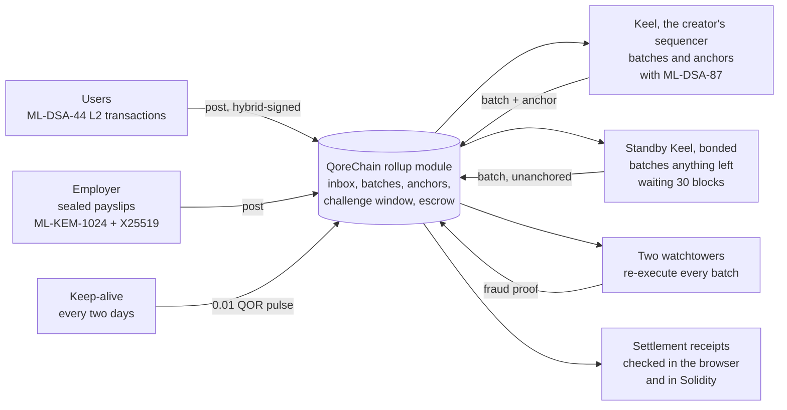

# Vigil

[](https://github.com/Manuel-dev01/Vigil/actions/workflows/ci.yml) [](https://github.com/Manuel-dev01/Vigil/actions/workflows/evidence-check.yml) [](https://build.qorechain.io/p/vigil)


**A payments rollup built to survive Q-Day, and proven on chain.** Vigil runs `vigil-pay-1`, a qledger-v1 optimistic rollup on the QoreChain testnet (`qorechain-diana`):
- Users sign with ML-DSA-44.
- Every batch from the sequencer is anchored with an ML-DSA-87 signature.
- Two watchtowers re-execute every batch and challenge fraud on chain.
- Payslips travel sealed with ML-KEM-1024.

Anyone can check a settlement receipt in their browser or in Solidity, against the chain rather than against our word.

> **Build Before Q-Day**, QoreChain Developer Fest, category **Protocol Builders**. Testnet only. Every claim below links to a row in [EVIDENCE.md](EVIDENCE.md): a transaction hash, an explorer link and a way to re-check it yourself.

**Web app: https://vigil-pq.up.railway.app** (its landing page follows one batch from signature to final, in 3D) · [Evidence ledger](EVIDENCE.md) · [Threat model](THREAT_MODEL.md) · [AI usage](AI_USAGE.md) · [Project page](https://build.qorechain.io/p/vigil)

## The six Protocol Builders requirements

Each row names the transaction to start with, its rows in [EVIDENCE.md](EVIDENCE.md), and a check you can run yourself without a key. EVM transactions do not open in the explorer; check them with `cast receipt <hash> --rpc-url https://evm-testnet.qore.host`. The explorer opens on mainnet: switch it to Testnet if a link shows "not found".

| Requirement | Best transaction | EVIDENCE | Check it yourself |
|---|---|---|---|
| **ML-DSA-signed batches** | Batch 0, anchored in its own submission transaction by the creator's ML-DSA-87 signature: [`E9532751…3D35`](https://explore.qore.network/tx/E953275101D707E1D93C69216FA8B9CEA2331EF5BBCA88A6F34DEC3F33813D35). Users sign their L2 transactions with ML-DSA-44 | 16 to 18, 123 | `curl -s https://api-testnet.qore.host/qorechain/multilayer/v1/anchors/vigil-pay-1` lists every anchor with its signature; the [Rollup page](https://vigil-pq.up.railway.app/#/rollup) shows each batch's anchor |
| **Withdrawal** | An L2 withdrawal paid on L1 with its qledger Merkle proof once batch 2 was final: [`FD1C8D24…BD66`](https://explore.qore.network/tx/FD1C8D24DC743039D9CD4CAD608B92066FE9B5E7E414FE835FC9B0751C5CBD66). An instant exit paid before finality: `0x6542b5f393cd4b37f349ef3b2e9edfe103d81b2f675d4ee48c0bd2f2de627c8f` (EVM) | 19 to 21, 99 to 109 | `curl -s https://api-testnet.qore.host/cosmos/tx/v1beta1/txs/FD1C8D24DC743039D9CD4CAD608B92066FE9B5E7E414FE835FC9B0751C5CBD66` shows `rdk_withdrawal_executed`; the [Exits page](https://vigil-pq.up.railway.app/#/exits) walks through the instant exit |
| **Verified settlement receipt** | Batch 0's anchor, verified inside the EVM through `pqcVerify` and recorded by `SettlementReceiptVerifier`: `0x4cd743bf56bc4666aba64751d337e81b67e8d629506aec98d987fa7642f3de9a` (EVM) | 57 to 64, 80, 112, 125 | [Verify batch 0 in your browser](https://vigil-pq.up.railway.app/#/verify?batch=0): nine checks, then **Forge it**. In Solidity: `cast call 0xc87c7680b70e21464aac4e2308a9caa5324e4590 "isAttested(uint64,bytes32)(bool)" 0 0x27cc24911b144e354f0154d22fbf5a9a2143655cc9763e90614b2aba6761959e --rpc-url https://evm-testnet.qore.host` |
| **Watchtower** | Our watchtower-2's fraud proof against a forged batch, upheld in the next block; the 1,000 QOR bond was slashed: [`4963FCFD…B915`](https://explore.qore.network/tx/4963FCFD2D33188456572D27C16D96DD2CB03604767DCBEEF0EDFB54E0F5B915) | 51 to 56 | `curl -s https://api-testnet.qore.host/cosmos/tx/v1beta1/txs/4963FCFD2D33188456572D27C16D96DD2CB03604767DCBEEF0EDFB54E0F5B915` shows `rdk_fraud_upheld` with challenger `qor1y6z2767n0uhann4q9dvdzujad8euj2x2z6z6yd`; the [Rollup page](https://vigil-pq.up.railway.app/#/rollup) lists every upheld challenge |
| **ML-KEM data protection** | January's payslip, sealed with ML-KEM-1024 and X25519 to three recipients and posted into the rollup's inbox: [`013F7B58…B982`](https://explore.qore.network/tx/013F7B58409CF2FF39099F9CA301E4EEA82BC941EC8FA3DB89C8CF37B7F7B982) | 32 to 38, 115, 117, 122, 123 | `pnpm --filter @vigil/sealed receipt -- verify --file receipts/vigil-pay-1/data-27.json --live` proves it sits in a final batch; the [Payslip page](https://vigil-pq.up.railway.app/#/payslip) opens it with a seal key |
| **Threat model** | [THREAT_MODEL.md](THREAT_MODEL.md) v1.7: adversaries, trust assumptions, the hosted keys and what stealing each would cost, both fraud drills, findings and residual risks | cited in each section | Start with [§13 Residual risks](THREAT_MODEL.md#13-residual-risks) and [§14 Instant exits](THREAT_MODEL.md#14-instant-exits-23-nov-2026) |

## Try it in a minute

1. **[Rollup](https://vigil-pq.up.railway.app/#/rollup).** `vigil-pay-1` live: its batches and their ML-DSA-87 anchors, its inbox, its deposit pool and bond, and the fraud caught on it. New posts and batches appear as the chain makes them.
2. **[Verify a receipt](https://vigil-pq.up.railway.app/#/verify?batch=0).**
   - Your browser rebuilds batch 0's settlement receipt from chain state and runs nine checks. These include the ML-DSA-87 signature, checked against the creator's key as the node reports it from the chain's PQ registry and against the key's hash pinned in the page, and whether the batch is final.
   - Our Solidity contract then checks the same anchor through the `pqcVerify` precompile.
   - Press **"Forge it"** to change one digit and watch it fail.
3. **[Instant exits](https://vigil-pq.up.railway.app/#/exits).** A 0.1 QOR withdrawal paid about an hour before its batch could be final, step by step: the L2 withdrawal, both watchtowers' ML-DSA-87 signatures (verified in your browser, and again by the chain's `pqcVerify` precompile), the payment, and the vault repaid after finality. Enter any address to get its exit address, computed in your browser and cross-checked with the vault. A table lists every exit the vault has fronted, with its timings, read from the chain; a dated snapshot is kept in [`docs/exits-metrics.json`](docs/exits-metrics.json) (6 exits at 17:57 UTC on 27 Nov, a small sample).
4. **[Open a payslip](https://vigil-pq.up.railway.app/#/payslip).** Three payslips, each sealed to three recipients, were posted into the rollup's public inbox: November's, December's and January's (inbox entries 6, 24 and 27; EVIDENCE 37, 115, 122). Anyone can see that each was posted and settled; only its recipients can read it. The chain deletes a posted-data record after 648,000 blocks, so entry 6's record goes around 30 Nov (EVIDENCE 115). The page does not need those records: it reads each entry from the transaction that posted it and checks it against the chain's inbox accumulator.

There is no server of ours in between: the page talks straight to a public QoreChain node over its websocket, and its files reproduce byte for byte from the commit named in `/version.json`. It does trust that node to report chain state truthfully (see [Limitations](#limitations)).

## Vigil in numbers

<!-- metrics:start (written by pnpm --filter @vigil/scripts metrics) -->
Read from the chain at block 10,862,210 (27 Nov 2026, 17:42 UTC) by `pnpm --filter @vigil/scripts metrics`, which makes about 34 read-only requests. Full table: [docs/METRICS.md](docs/METRICS.md).

| Number | What it counts | Source |
|---|---|---|
| **8 days** live on testnet | vigil-pay-1 created at block 10,351,825, 19 Nov 2026 | EVIDENCE 13; chain read 27 Nov 2026 |
| **33 of 33** anchors verify (ML-DSA-87) | checked against the creator's key as the node reports it; 25 final batches carry their own verified anchor | chain read 27 Nov 2026 |
| **25** anchors verified in Solidity | recorded by SettlementReceiptVerifier through pqcVerify, through layer height 25; 0 conflicts | EVIDENCE 62, 63, 80, 112, 125; chain read 27 Nov 2026 |
| **1 block** from forged batch to upheld challenge | fraud drill 2: batch 8, our watchtower-2's challenge; 1,000 QOR bond slashed | EVIDENCE 54, 55 |
| **4 instant exits** paid before finality | a small sample (n = 4); the fastest was paid 23 s after its withdrawal was posted; every exit whose batch is final is repaid; 0.55 QOR is owed on 2 exits whose batch is not final yet | EVIDENCE 91, 104; chain read 27 Nov 2026 |
| **3** payslips sealed with ML-KEM-1024 | posted in the rollup's inbox by employer-1; a payment and its payslip cost about 0.26 QOR in fees | EVIDENCE 37, 115, 122; chain read 27 Nov 2026 |
<!-- metrics:end -->

## What is proven on chain

| Claim | Evidence | Check it yourself |
|---|---|---|
| **A post-quantum rollup, running continuously on testnet since 19 Nov.** `vigil-pay-1` had 26 batches at 16:50 UTC on 27 Nov (height 10,860,020), and the keep-alive adds one every two days. Each batch from the creator's sequencer is anchored in its own submission transaction by an ML-DSA-87 signature: 25 of the 26 (the standby's batch 11 has none) | [EVIDENCE](EVIDENCE.md) 13 to 23, 71, 76, 78; [read-only check of 27 Nov](EVIDENCE.md#ro-receipts) | `curl -s https://api-testnet.qore.host/qorechain/multilayer/v1/anchors/vigil-pay-1` |
| **Fraud caught by our watchtower.** In our fraud drill 2, a separate bonded key submitted a wrong batch. Watchtower-2's challenge was upheld in the very next block; the 1,000 QOR bond was slashed and 500 QOR paid to our watchtower | 51 to 56 | the web app's "Fraud caught on chain" panel |
| **Kill the sequencer.** We stopped the creator's sequencer. A bonded standby on another key, in another region, batched a user's withdrawal; both watchtowers judged it valid, and it was paid on L1 with no help from the creator | 65 to 72 | [THREAT_MODEL §7](THREAT_MODEL.md) |
| **Receipts checked in Solidity.** [`SettlementReceiptVerifier`](contracts/src/SettlementReceiptVerifier.sol) at `0xc87c7680b70e21464aac4e2308a9caa5324e4590` (no owner) rebuilds the anchor message and verifies the ML-DSA-87 signature through `pqcKeyStatus` and `pqcVerify`, at about 230k to 280k gas. It has recorded 25 of `vigil-pay-1`'s anchors, every one through layer height 25 (27 Nov); anyone can add newer ones with `attest` | 57 to 64, 79 to 81, 110 to 113, 124 to 126 | `cast call 0xc87c7680b70e21464aac4e2308a9caa5324e4590 "isAttested(uint64,bytes32)(bool)" 0 0x27cc24911b144e354f0154d22fbf5a9a2143655cc9763e90614b2aba6761959e --rpc-url https://evm-testnet.qore.host` |
| **Sealed payslips.** A payslip sealed with QoreSeal (ML-KEM-1024 with X25519) was posted into the rollup's inbox, opened by its three recipients and no one else, and covered by a data receipt. A December one followed on 24 Nov and a January one on 26 Nov, so fresh payslips stay on chain while the chain prunes older posted data; their data receipts verify against the final batches 21 and 24 | 28 to 38, 114, 115, 117, 121 to 123 | the web app's payslip page |
| **Instant exits.** A user's 0.1 QOR withdrawal was paid to their wallet 68 blocks after its batch, about an hour before L1 could pay it. Both watchtowers re-executed the batch and signed for the withdrawal with ML-DSA-87; [`InstantExitVault`](contracts/src/InstantExitVault.sol) checked the signatures through `pqcVerify` and fronted the money from LP liquidity. Since 24 Nov a hosted relayer does this with nobody in the loop: its first exit was paid 11 blocks after the batch, about 23 s after the withdrawal was posted (block timestamps, one exit), and the vault was repaid automatically after finality. Without the quorum the user still gets everything at finality; the LP, not the user, carries the quorum risk | 82 to 109; [read-only check of 27 Nov](EVIDENCE.md#ro-exit-time) | [THREAT_MODEL §14](THREAT_MODEL.md) |
| **Withdrawals to L1.** An L2 withdrawal was committed in a batch and paid on L1 with its qledger proof once final; a second claim was refused | 19 to 21, 72 | `GET /qorechain/rdk/v1/batch/vigil-pay-1/2` |
| **Q-Day Drill.** The fest accepted our drill-day proof from the registered account, which has never opened an EVM window. The PQ-guarded vault design is in rows 1 to 8 | 12 | [THREAT_MODEL §6](THREAT_MODEL.md) |
| **Receipts outlive the chain's retention windows.** The chain's parameters allow it to delete finalized batch records after 432,000 blocks; as of 27 Nov we have not seen that happen (the node still serves `vigil-pay-1`'s batch 0 record, about 505,000 blocks after it was finalized, and on 24 Nov served records 750,000 blocks old). It does delete posted data after 648,000 blocks, which we have observed. A keep-alive job keeps fresh anchored batches coming, and the web app verifies a receipt whose batch record is gone against its surviving anchor | 73 to 78; [read-only check of 27 Nov](EVIDENCE.md#ro-receipts) | `GET /qorechain/rdk/v1/params` |
| **Five RDK languages agree.** We ran 10,056 generated rollup histories (mostly valid transactions, recipients of 1 to 90 bytes) through the TypeScript, Go, Rust, Python and Java implementations of qledger-v1. All five gave the same state roots, withdrawals roots and withdrawals | read-only | [`scripts/fuzz/`](scripts/fuzz) |
| **Upstream contribution.** A qledger-v1 batch validator for watchtowers, so they judge batches by re-execution, in all five RDK languages. Open, and green on each language's CI in our fork | [qorechain/qorechain-rdk#1](https://github.com/qorechain/qorechain-rdk/pull/1) | the PR's tests |
| **Attacked by us.** On 24 Nov six reviewers tried to break every part of Vigil. The findings that put money or fraud detection at risk were fixed, tested and deployed the same night | [THREAT_MODEL §12](THREAT_MODEL.md#12-findings) | the tests named there |

## How it works



**Post-quantum at every layer**

| Where | Primitive | Code |
|---|---|---|
| L2 transactions | ML-DSA-44 (qledger-v1) | `@qorechain/rdk`, `packages/keel` |
| Batch anchors and settlement receipts | ML-DSA-87, signed by the rollup creator, key read from the chain's PQ registry | `packages/keel`, `apps/web` |
| Every operator transaction on L1 (sequencers, watchtowers, keep-alive, exit relayer) | Hybrid secp256k1 + ML-DSA-87. None of the sequencer, watchtower or keep-alive keys has ever opened an EVM window. Three single-purpose keys have, briefly, each closing it after use: the first deployer (PQGuardVault, 17 Nov), the EVM deployer, and the exit relayer, whose windows admit only its calls to the vault | `packages/keel/src/chain.ts`, `packages/qledger-watchtower/src/challenger.ts`, `packages/exit-relayer` |
| Receipts inside the EVM | `pqcKeyStatus` and `pqcVerify` precompiles | `contracts/src/SettlementReceiptVerifier.sol` |
| Instant exits | Two watchtowers' ML-DSA-87 signatures, checked by the vault through `pqcVerify` | `contracts/src/InstantExitVault.sol`, `packages/qledger-watchtower/src/exits.ts`, `packages/exit-relayer` |
| Confidential payroll data | ML-KEM-1024 with X25519 (QoreSeal) | `packages/sealed` |

What this does and does not protect against, and what each hosted key could do if stolen, is in the [threat model](THREAT_MODEL.md).

## What is new here

- **Settlement receipts checked in Solidity, with an on-chain record.** A contract with no owner rebuilds the rollup's anchor message byte for byte and verifies the creator's ML-DSA-87 signature through the chain's precompiles, so EVM code can rely on rollup state without a classical signature anywhere.
- **Confidential data inside the rollup itself.** Sealed payslips travel in the same inbox and settle in the same batches as the payments they explain, with data receipts that prove a ciphertext is in a settled batch.
- **Liveness without trusting the creator.** A second, bonded sequencer on another key in another region took over when we stopped the first, and the withdrawal it batched was paid on L1.
- **Instant exits whose only authority is ML-DSA-87.** Watchtowers sign exits from their own re-execution, the vault checks the signatures on chain, and the relayer that pays them can reach the EVM only through windows its post-quantum key opens for exactly its calls.
- **Upstream work.** The qledger-v1 validator the RDK's watchtower lacked, in all five RDK languages, and a differential fuzzer across them.

## How Vigil differs

Every row about another project quotes or paraphrases that project's own public files, linked at the version we read on 27 Nov 2026. Where those files do not say, the cell says so.

### How Vigil's exits differ

Wicketgate, another Protocol Builders entry, also pays rollup withdrawals before finality.

| | Vigil (`InstantExitVault`) | Wicketgate |
|---|---|---|
| Who signs an exit | A fixed quorum: watchtower-2 and watchtower-3 must both sign, and our team runs both, on Railway (EVIDENCE 83, [THREAT_MODEL §14](THREAT_MODEL.md#14-instant-exits-23-nov-2026)) | "Any staked watcher with a proven ML-DSA-87 key" ([README](https://github.com/timix648/wicketgate/blob/9644b53d480180e07bb0abdcd2e3fd7ba4f61aac/README.md#L19)) |
| If the signers lie | The LP loses up to its liquidity. A user loses at most the 0.5% fee, and without the quorum is paid in full at finality ([THREAT_MODEL §14](THREAT_MODEL.md#14-instant-exits-23-nov-2026)) | "The watchers' stake is slashed", and a pool advances no more than the stake locked behind a batch ([README](https://github.com/timix648/wicketgate/blob/9644b53d480180e07bb0abdcd2e3fd7ba4f61aac/README.md#L20)) |
| Keys over the exit contract | None: `InstantExitVault` has no owner, pause or upgrade path. Taking liquidity out needs the LP's ML-DSA-87 signature ([source](contracts/src/InstantExitVault.sol)) | `LaneHub`, which opens lanes, has "no owner or admin" ([README](https://github.com/timix648/wicketgate/blob/9644b53d480180e07bb0abdcd2e3fd7ba4f61aac/README.md#L26)). Each lane's pool needs its opener's two admin keys, proven ML-DSA-87 keys ([README](https://github.com/timix648/wicketgate/blob/9644b53d480180e07bb0abdcd2e3fd7ba4f61aac/README.md#L152)). In their main `ExitPool`, the two admins act by ML-DSA-87 signature: either can pause new instant exits, and both together change risk and lane settings ([ExitPool.sol](https://github.com/timix648/wicketgate/blob/9644b53d480180e07bb0abdcd2e3fd7ba4f61aac/contracts/src/ExitPool.sol#L642-L675)) |
| Signing keys and EVM windows | Watchtower keys never open an EVM window: they post their signatures into the rollup's inbox, and the vault checks them with `pqcVerify` (EVIDENCE 88, 91, [THREAT_MODEL §14](THREAT_MODEL.md#14-instant-exits-23-nov-2026)) | "Watchers open windows to work" ([README](https://github.com/timix648/wicketgate/blob/9644b53d480180e07bb0abdcd2e3fd7ba4f61aac/README.md#L62)). `ExitPool` checks each attestation's ML-DSA-87 signature in the contract, so in their Q-Day simulation a stolen classical key with an open window could not attest ([README](https://github.com/timix648/wicketgate/blob/9644b53d480180e07bb0abdcd2e3fd7ba4f61aac/README.md#L63)) |
| Rollups served | `vigil-pay-1` | "Any QoreChain rollup", through lanes anyone can open ([README](https://github.com/timix648/wicketgate/blob/9644b53d480180e07bb0abdcd2e3fd7ba4f61aac/README.md#L21)) |
| Exits paid so far | 4 by our chain read of 27 Nov 2026, a small sample ([docs/METRICS.md](docs/METRICS.md); EVIDENCE 91 and 104 record the two from 23 and 24 Nov) | 28, by their count dated 19 Nov ([README](https://github.com/timix648/wicketgate/blob/9644b53d480180e07bb0abdcd2e3fd7ba4f61aac/README.md#L41)) |

Another team's exit service paid an instant exit from `vigil-pay-1` on 19 Nov ([Wicketgate's PROOF.md](https://github.com/timix648/wicketgate/blob/9644b53d480180e07bb0abdcd2e3fd7ba4f61aac/PROOF.md#L68)).

### How Vigil Payroll compares

| | Vigil Payroll | Veil | Cista | Zama confidential USDT payroll (Bron) |
|---|---|---|---|---|
| Source | [`packages/sealed`](packages/sealed/src/payslip.ts), EVIDENCE 28 to 38, 115, 122 | [README](https://github.com/ryssroad/veil/blob/c9b651c5d72e38eedb93c6142bd93cf10d12ef37/README.md) | [README](https://github.com/phoenix-2203/cista/blob/0c9fd9fa91b4aabe72a03fe1228b56e3b30567ea/README.md) | Zama's [post of 16 Jan 2026](https://www.zama.org/post/the-first-confidential-payroll-on-ethereum-mainnet) and [payroll page](https://www.zama.org/solutions/confidential-onchain-payroll) |
| What is hidden | The payslip: gross pay, deductions, period and note. Also who can open it: recipient slots are anonymous | The invoice: who, what for, reference numbers ([L14](https://github.com/ryssroad/veil/blob/c9b651c5d72e38eedb93c6142bd93cf10d12ef37/README.md#L14)) | The payslip: gross pay, tax, deductions, role and personal details ([L163](https://github.com/phoenix-2203/cista/blob/0c9fd9fa91b4aabe72a03fe1228b56e3b30567ea/README.md#L163)) | Amounts and balances, encrypted with FHE ([post](https://www.zama.org/post/the-first-confidential-payroll-on-ethereum-mainnet)) |
| What stays public | The payment it explains, so net pay (its L2 accounts and amount), and the envelope's size, time and poster | "Accounts, amounts and timing" ([L47](https://github.com/ryssroad/veil/blob/c9b651c5d72e38eedb93c6142bd93cf10d12ef37/README.md#L47)) | Net pay: the payment is a public on-chain transfer, a `MsgMultiSend` of fUSD ([L71](https://github.com/phoenix-2203/cista/blob/0c9fd9fa91b4aabe72a03fe1228b56e3b30567ea/README.md#L71), [L163](https://github.com/phoenix-2203/cista/blob/0c9fd9fa91b4aabe72a03fe1228b56e3b30567ea/README.md#L163)) | "Sender and receiver addresses" ([payroll page](https://www.zama.org/solutions/confidential-onchain-payroll)) |
| What signs | The payment: the payer's ML-DSA-44 key. The post: the employer's hybrid secp256k1 + ML-DSA-87 transaction. The payslip itself is not signed; the chain vouches for its poster | The payer's ML-DSA-44 transfer key signs the invoice, bound to the transfer's bytes ([L56](https://github.com/ryssroad/veil/blob/c9b651c5d72e38eedb93c6142bd93cf10d12ef37/README.md#L56)) | The employer signs the pay run in QoreX (hybrid secp256k1 + ML-DSA-87); the employee signs each proof with ML-DSA-87 ([L69](https://github.com/phoenix-2203/cista/blob/0c9fd9fa91b4aabe72a03fe1228b56e3b30567ea/README.md#L69), [L91-L94](https://github.com/phoenix-2203/cista/blob/0c9fd9fa91b4aabe72a03fe1228b56e3b30567ea/README.md#L91-L94)) | Not stated on the pages we read |
| Who can read it | Its three recipients, the employee, the employer and an auditor (QoreSeal: ML-KEM-1024 with X25519). Anyone can check that it sits in a final batch (a data receipt) | Two readers: the payee and an auditor named in the invoice, sealed with ML-KEM-1024 ([L14](https://github.com/ryssroad/veil/blob/c9b651c5d72e38eedb93c6142bd93cf10d12ef37/README.md#L14), [L46](https://github.com/ryssroad/veil/blob/c9b651c5d72e38eedb93c6142bd93cf10d12ef37/README.md#L46)) | The employee and the employer, sealed with ML-KEM-1024 and X25519 ([L70](https://github.com/phoenix-2203/cista/blob/0c9fd9fa91b4aabe72a03fe1228b56e3b30567ea/README.md#L70)). The employee can prove chosen fields, bands or ranges to a named recipient until an expiry ([L78-L91](https://github.com/phoenix-2203/cista/blob/0c9fd9fa91b4aabe72a03fe1228b56e3b30567ea/README.md#L78-L91)), and a contract can check such a proof on chain ([L103](https://github.com/phoenix-2203/cista/blob/0c9fd9fa91b4aabe72a03fe1228b56e3b30567ea/README.md#L103)) | Set role by role through an access control list; Bron's payroll was visible to sender and recipient ([payroll page](https://www.zama.org/solutions/confidential-onchain-payroll)) |
| Where the ciphertext lives | In the rollup's inbox, settled in a batch | In the rollup's inbox, posted in the same L1 transaction as the transfer ([L56](https://github.com/ryssroad/veil/blob/c9b651c5d72e38eedb93c6142bd93cf10d12ef37/README.md#L56)) | On Cista's server ([L181](https://github.com/phoenix-2203/cista/blob/0c9fd9fa91b4aabe72a03fe1228b56e3b30567ea/README.md#L181)) | On chain, as encrypted amounts and balances ([post](https://www.zama.org/post/the-first-confidential-payroll-on-ethereum-mainnet)) |

## For jurors: where the post-quantum checks are

| Check | Code | On chain |
|---|---|---|
| `pqcKeyStatus` (registered ML-DSA-87 key, proof of possession) | `contracts/src/SettlementReceiptVerifier.sol:129`, `contracts/src/InstantExitVault.sol:192`, `contracts/src/PQGuardVault.sol:69` | EVIDENCE 62, 63, 80, 91, 104, 112 |
| `pqcVerify` (ML-DSA-87, FIPS 204 pure, empty context) | `contracts/src/SettlementReceiptVerifier.sol:143`, `contracts/src/InstantExitVault.sol:285`, `contracts/src/PQGuardVault.sol:127` | EVIDENCE 62, 63, 80, 91, 104, 112; PQGuardVault's live check is the 17 Nov row under the numbered ones |
| Hybrid secp256k1 + ML-DSA-87 transactions | `packages/keel/src/chain.ts`, `packages/qledger-watchtower/src/challenger.ts` | `pqc_hybrid_verify` `verified` on every operator tx, e.g. EVIDENCE 97, 106 |
| PQ key registration with proof of possession | `scripts/drill/register-pqc.ts` | EVIDENCE 58, 74, 98 |
| Scoped EVM windows | `packages/exit-relayer/src/relayer.ts` (`openWindow`), `scripts/evm/receipt-verifier.ts` | EVIDENCE 79, 103, 107, 111 |
| ML-KEM-1024 sealing and the KEM registry | `packages/sealed` | EVIDENCE 28 to 38, 115 |

## Limitations

- **Testnet only**, and nearly all traffic on `vigil-pay-1` is ours.
- **The web app trusts the node it reads.** Reads come from one public QoreChain node and its EVM endpoint, without proofs. A dishonest node could show a false chain state, including a false key and anchors. Signatures marked "in your browser" are verified locally, but against what the node says.
- **The instant-exit quorum is two keys run by one team on one host.** Stealing both, or the LP key (the rollup creator's), could drain the vault's liquidity, never a user's withdrawal. The relayer serves only payouts it is told about (configured, or announced with a payout notice).
- **The Solidity verifier proves a signature, not finality.** It shows that the creator signed a state root. Whether that batch is final is chain state, which the browser check covers.
- **Classical dependencies remain below us:** QoreChain's consensus keys (Ed25519), TLS to the node, and the first, classical-signed PQ key registration of each account. The full list is in the [threat model](THREAT_MODEL.md).

## Run it yourself

Requires Node 20+, pnpm, and Foundry for `contracts/`.

```bash
pnpm install
pnpm test                      # 456 TypeScript tests (28 more are skipped: 27 need a live chain, 1 a Foundry build)
(cd contracts && forge test)   # 110 Foundry tests, including invariant fuzzing of the vault
pnpm --filter @vigil/web dev   # the web app, reading the live chain
```

- Re-check every numbered [EVIDENCE](EVIDENCE.md) row against the chain, read-only and at one request a second (about three minutes): `pnpm evidence:check`. On 27 Nov it re-verified 123 of 123 rows at height 10,863,256, as the node reports ([docs/evidence-check.md](docs/evidence-check.md)); a scheduled workflow repeats it daily (the badge above).
- Replay `vigil-pay-1` from chain data and compare the state roots: `packages/qledger-watchtower`.
- Re-run the differential fuzzer: [`scripts/fuzz/README.md`](scripts/fuzz/README.md).
- Check the Solidity verifier without spending anything: `pnpm --filter @vigil/scripts evm:verifier status`.

## Testnet addresses

| Role | Address |
|---|---|
| Rollup creator and sequencer (Keel); registered Q-Day Drill account | `qor1z6m6kshavs5zjvd3tz0nu9tjpde5p7w83mj90s` |
| Standby sequencer (keel-b) | `qor1qwker9qw2l4jpsudwkkkcrwnc9a29xpvw36gft` |
| Watchtower-2 (US West) | `qor1y6z2767n0uhann4q9dvdzujad8euj2x2z6z6yd` |
| Watchtower-3 (EU West) | `qor1z0mxtgun49kfwfsx4naww4m4g3paew50v3lp33` |
| Keep-alive poster | `qor12t0u9hrz2qnfmkrpp3k5u3s9mghsz9vdwkjd6l` |
| EVM deployer | `qor1qdf0xu8fvmp0uchhhdfcx7mq893h65jk8yfcp6` |
| Exit relayer | `qor1vwqwy8nqj060e8ufdze7qlnsq7lsjaxsfhf8hn` |
| Sealed payroll demo: employer-1 | `qor1r74gzxy9u495j0jz9xl2gf69uy2gwxfa7l5pws` |
| First deployer (PQGuardVault, 17 Nov) | `qor1r0zkpgngnrc30qtskf2l5ewv0v9kqwjwn5m6yv` |
| Watchtower-1 (19 Nov, a laptop; retired) | `qor1s7t0tq7n6a3m6kp4qkannfd7s04wyuh8hjkh6m` |
| `SettlementReceiptVerifier` (EVM, chain id 9800) | `0xc87c7680b70e21464aac4e2308a9caa5324e4590` |
| `InstantExitVault` (EVM, chain id 9800) | `0x3a897802b62b052a102f55e021bc4668539c29b5` |
| `PQGuardVault` (EVM, chain id 9800) | `0x40b6b90d69b4a6e2277583ff7d98912c03255591` |

## Full status

| Piece | State |
|---|---|
| Inbox replay matches on-chain roots (watchtower seed) | **12 of 12** live batches on two rollups reproduced (read-only: `scripts/spike-a-replay.ts`, offline test in `scripts/test/`) |
| `pqcVerify` / `pqcKeyStatus` probed via `eth_call` | Done (read-only): FIPS 204 pure ML-DSA-87, empty context; ~312k gas per direct call (`scripts/spike-b-pqcverify.ts`) |
| Q-Day Drill vault (`PQGuardVault`) | Deployed at `0x40b6b90d69b4a6e2277583ff7d98912c03255591`, 25 QOR, accepts a real ML-DSA-87 signature via `pqcVerify` (EVIDENCE rows 1 to 8); 21 Foundry tests |
| Our rollup `vigil-pay-1` (qledger-v1, based, optimistic) | Created and bonded 19 Nov (EVIDENCE 13 and 14). Our sequencer Keel (`packages/keel`) has batched a deposit, a transfer and a withdrawal (batches 0 to 2, all finalized; EVIDENCE 15 to 20). Keel now runs hosted, always on, and submitted batch 3 unattended (EVIDENCE 22 and 23). At 16:50 UTC on 27 Nov (height 10,860,020) the rollup had 26 batches (0 to 25), all final, as the node reports ([read-only check of 27 Nov](EVIDENCE.md#ro-receipts)) |
| Sequencer failover ("kill the sequencer") | Two sequencers on two bonded keys in two regions: Keel, run by the creator, and a standby Keel (`KEEL_STANDBY_BLOCKS=30`). On 20 Nov the creator's Keel was stopped. The standby batched a user's L2 withdrawal (unanchored, since only the creator can anchor), both watchtowers judged it valid, and the withdrawal was paid on L1 once final. The creator's Keel then came back and anchored again (EVIDENCE 65 to 72; [THREAT_MODEL §7](THREAT_MODEL.md)) |
| qledger-v1 across the RDK's five languages | Differential fuzzer ([`scripts/fuzz/`](scripts/fuzz)): the same generated rollup histories run through TypeScript, Go, Rust, Python and Java. 10,056 cases, 0 divergences in state roots, withdrawals roots and withdrawals |
| Anchored batches and settlement receipts | Every `vigil-pay-1` batch from the creator's Keel is anchored in its submission tx by ML-DSA-87: 25 anchors at height 10,860,020 (27 Nov), every batch but the standby's batch 11. Settlement receipts for all 25, rebuilt and verified with a live client at that height, are in `receipts/vigil-pay-1/` ([read-only check of 27 Nov](EVIDENCE.md#ro-receipts)). Our replay matched batches 0 to 3 (EVIDENCE 16, 18, 20, 23), and the watchtowers re-execute every batch |
| Withdrawals | One L2 withdrawal (0.25 QOR) committed in batch 2 and executed on L1 with its qledger proof once final; a second claim is refused (EVIDENCE 19 to 21) |
| Settlement receipts in the browser and in Solidity | The [web app](apps/web) (https://vigil-pq.up.railway.app) builds and checks a receipt for any batch against the live chain, in the browser, with no server of ours, and requires the batch to be final. [`SettlementReceiptVerifier`](contracts/src/SettlementReceiptVerifier.sol) at `0xc87c7680b70e21464aac4e2308a9caa5324e4590` (no owner) checks anchors inside the EVM through `pqcKeyStatus` and `pqcVerify`. It has verified and recorded 25 `vigil-pay-1` anchors on chain, every one through layer height 25: 11 on 19 Nov, 3 on 23 Nov, 5 on 24 Nov and 6 on 27 Nov, each later round through a window scoped to the contract (EVIDENCE 57 to 64, 79 to 81, 110 to 113, 124 to 126). Newer anchors (the keep-alive adds one every two days) can be recorded by anyone. What it does and does not prove is in [THREAT_MODEL §13](THREAT_MODEL.md#13-residual-risks); 19 Foundry tests |
| Receipts that outlive the chain's retention windows | The chain's parameters allow it to delete a finalized batch's record after 432,000 blocks (about 7 days on testnet); as of 27 Nov that has not been observed (batch 0's record is still served about 505,000 blocks after finality). Anchors stay either way. Posted data is deleted after 648,000 blocks, and that is observed. A keep-alive job (`packages/keel/src/pulse.ts`, a Railway cron every two days) posts a 0.01 QOR L2 transfer from its own hybrid-signed key so the rollup keeps producing anchored batches, and keeps a ledger snapshot on a volume so it never has to replay pruned batches. First runs: batches 13 and 14, both anchored (EVIDENCE 73 to 78) |
| Instant exits | `InstantExitVault` (no owner) pays a withdrawal before its batch is final when watchtower-2 and watchtower-3 have both re-executed the batch and signed the exit with ML-DSA-87. The watchtowers attest automatically (`WATCHTOWER_EXIT_VAULT`) by posting signatures into the inbox. First exit: 0.0995 QOR paid 68 blocks after its batch, relayed by hand (EVIDENCE 82 to 96). Since 24 Nov the relayer is automatic (`packages/exit-relayer`, its own key, EVIDENCE 97 and 98). Its first exit was paid **11 blocks after its batch with nobody in the loop**, about 23 s after the withdrawal was posted (block timestamps; [read-only check of 27 Nov](EVIDENCE.md#ro-exit-time)), through a window open for 5 blocks that admitted only that one call; after finality it executed the withdrawal 5 blocks later and repaid the vault the same way (EVIDENCE 99 to 109). It fronts each attested exit, and after finality executes the withdrawal and sweeps the exit address back to the vault. It opens an EVM window only when it has calls to make, scoped to the vault and capped at those calls' fees, and closes it after. Bounded so that nobody can make it, or the watchtowers' attesting, spend more than a small budget ([THREAT_MODEL §14](THREAT_MODEL.md)). Every fronted exit is measured from block times by `scripts/exit/metrics.ts` into [`docs/exits-metrics.json`](docs/exits-metrics.json) and shown on the Exits page. At 17:57 UTC on 27 Nov there were 6, a small sample: the first paid 175 s after its batch, relayed by hand (EVIDENCE 91), and the five since 15 to 25 s after theirs; 2 repaid, 4 waiting for finality. A daily canary exit (`packages/exit-canary`) is written but not yet deployed |
| qledger-v1 watchtower, fraud challenge | Watchtower (`packages/qledger-watchtower`) runs in challenge mode on `vigil-pay-1` from two keys in two Railway regions, watchtower-2 (US West, primary) and watchtower-3 (EU West, 3 s backup), each following new batches over the chain websocket (EVIDENCE 24 to 27, 46 to 47). Its first live pass found 44 of 44 batches valid on four rollups (read-only check). Fraud drill 1 was upheld on chain and the bond slashed, but another team's watcher won the race: watchtower-2's challenge reached the same block and lost on its position within it (EVIDENCE 116), and watchtower-1's came 4 blocks later (EVIDENCE 39 to 45). That led to the fast path. **Fraud drill 2: our watchtower-2 won**, upheld in the block right after the wrong batch; the 1,000 QOR bond was slashed and 500 QOR paid to our watchtower (EVIDENCE 51 to 56) |
| ML-KEM-1024 sealed data lane | First sealed payslip posted into `vigil-pay-1` (`packages/sealed`): QoreSeal hybrid envelope, recipients' ML-DSA-87 and ML-KEM-1024 keys registered on chain, opened by its three recipients and by no one else, and covered by a data receipt against batch 5 (EVIDENCE 28 to 38). A December payslip followed on 24 Nov (EVIDENCE 114 and 115), and a January payslip on 26 Nov (EVIDENCE 121 to 123) |
| Reading the inbox, and pruning | One shared reader (`packages/core/src/inbox`) fetches each inbox entry by sequence and checks it against the chain's accumulator; Keel, the keep-alive, the relayer and the payslip tools use it. A public archive of every entry (`data/inbox/vigil-pay-1.jsonl`, refreshed by `scripts/inbox-archive.ts`) is used only for entries the chain has pruned, and only after a commitment the chain still holds confirms them. Keel logs a heartbeat every 10 minutes whether its passes succeed or not, and the keep-alive's exit code says whether it did its job |
| Monitoring | A keyless sentinel (`packages/sentinel`) reads the chain every minute and alerts the team on Telegram: an EVM window on a key that must never open one, low balances, a stuck sequencer, disputes, an unrepaid vault, the web app down. It also re-executes every batch with the watchtower's core and alerts, repeatedly, if a bad batch is still unchallenged halfway through its challenge window, and warns when an exit the relayer serves is not fronted within 5 minutes of its batch. Both rules are tested on recorded chain data; neither has fired on chain (not yet exercised) |
| Web app hardening (24 Nov) | Watchtower attestations are accepted only from the member's own account and only after their ML-DSA-87 signature verifies in the browser against pinned key hashes; `pqcVerify` is a second, labelled check. Exit addresses are computed in the browser from the pinned ExitAddress code. Pages survive posted-data pruning, show live-feed health truthfully, and say which checks ran where. First load is about 80 KB gzipped |
| Continuous integration | GitHub Actions run the typecheck, the TypeScript tests and the Foundry tests on every push and pull request |
| Threat model | [v1.7](THREAT_MODEL.md) (27 Nov): adversaries and trust assumptions, both fraud drills, how the hosted operator keys are held and what a theft of each would cost, measured challenge and rollback behaviour, instant exits, the 24 Nov adversarial study, findings and residual risks |

## Layout

```
packages/core                shared config and chain helpers
packages/chain-ws            the chain over its websocket: RPC, REST over abci_query, chain descriptors
packages/keel                sequencer (with standby mode) and the keep-alive pulse
packages/qledger-watchtower  replay, validator, fraud proofs, challenger, exit attestations
packages/exit-relayer        pays instant exits automatically: fronts, executes, sweeps
packages/exit-canary         a daily instant exit of its own money (code only, not deployed)
packages/sentinel            keyless monitoring with Telegram alerts, and its own re-execution
packages/sealed              QoreSeal envelopes, KEM registration, payslips, data receipts
contracts/                   Foundry contracts and tests
apps/web                     rollup explorer, receipt verifier, instant exits, payslip opener
scripts/                     spikes, rollup, EVM, drill and fuzzing scripts
receipts/                    saved settlement and data receipts
test/vectors/                recorded chain data and shared vectors
```

## Built with

QoreChain kits:
- [`@qorechain/rdk`](https://www.npmjs.com/package/@qorechain/rdk) 0.9.0: qledger-v1 execution, batch planning, fraud proofs, receipts. The fuzzer also runs the RDK's Go, Rust, Python and Java implementations.
- [`@qorechain/sdk`](https://www.npmjs.com/package/@qorechain/sdk): accounts, hybrid signing, PQ key registry.
- `@qorechain/qoreseal`: ML-KEM-1024 envelopes and the KEM registry.
- QoreChain EVM precompiles `pqcVerify` and `pqcKeyStatus`.

## Team

- OoJae ([@OoJae](https://github.com/OoJae))
- Olamiye Emmanuel ([@Manuel-dev01](https://github.com/Manuel-dev01))

An AI coding agent wrote much of the code with us. [AI_USAGE.md](AI_USAGE.md) records what it did and what we reviewed or decided.

## Licence and credits

Apache-2.0. See [LICENSE](LICENSE) and [NOTICE](NOTICE). Vigil builds on open-source software, listed with its licences in [CREDITS.md](CREDITS.md).
