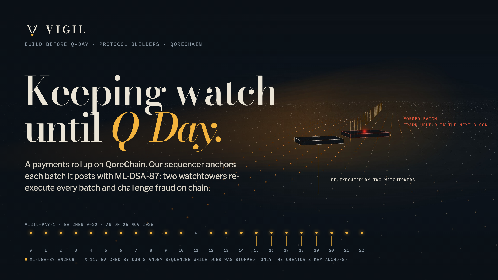

# Vigil brand

Vigil keeps watch over a rollup through the night before Q-Day. The brand takes its materials from two
places:
- **The night watch at sea.** Sector lights on Admiralty charts, the ship's log, and a ship's port (red) and starboard (green) lights.
- **The lattices under ML-DSA and ML-KEM.**

Use it for the web app, the cover, the video and anything else people see. The tokens in code are in
[`apps/web/src/brand/brand.css`](../apps/web/src/brand/brand.css), and the mark is
[`apps/web/src/brand/Mark.tsx`](../apps/web/src/brand/Mark.tsx).



## The mark

A **sector light**: a lamp at the base casts a V of light, crossed by the arc that charts draw across a
light's sector. The V is also the initial.

| File | Use |
|---|---|
| `svg/vigil-mark-day.svg`, `svg/vigil-mark-night.svg` | the mark on light and on dark grounds |
| `svg/vigil-lockup-day.svg`, `svg/vigil-lockup-night.svg` | mark and wordmark together |
| `svg/vigil-wordmark-*.svg` | the word alone (outlined, needs no font) |
| `svg/vigil-icon.svg`, `png/vigil-icon-512.png` | app icon, avatars |
| `svg/vigil-favicon.svg` | 16 to 32 px: the arc is dropped and the edges are thicker |

Rules:
- The lamp is always lamp amber, `#F3B33D`. The beam edges and the arc take the ink of the ground: `#0C1319` on light, `#EAE4D6` on dark.
- Keep clear space of half the mark's height on every side.
- Below 24 px, use the favicon version.
- Don't rotate the mark, outline it, add a glow, or put the lamp anywhere but the base of the V.

The wordmark is **VIGIL** in Bodoni Moda, weight 520, optical size 96, tracked +0.24 em. In the lockup the
word's baseline sits level with the centre of the lamp.

## Colour

The night is the ground; the lamp is the only accent. Red and green are not decoration: they mean
failed and passed.

| Token | Night | Day | Role |
|---|---|---|---|
| `--night` | `#0A1016` | `#EDF0F1` | the ground |
| `--swell` | `#111A22` | `#F9FAFA` | raised surfaces (panels) |
| `--rule` | `#1F2B35` | `#CDD5DA` | hairlines |
| `--chart` | `#EAE4D6` | `#0C1319` | ink |
| `--sounding` | `#8E9BA7` | `#4C5964` | secondary ink, labels |
| `--lamp` | `#F3B33D` | `#8A5400` | the accent: links, the primary button, what the watch has lit |
| `--port` | `#EE5A3F` | `#B3301B` | fraud, a failed check |
| `--starboard` | `#4CC08E` | `#1C764B` | a passed check, final |

Contrast against the ground, with a floor of 4.5:1 for body text:

| Pairing | Night | Day |
|---|---|---|
| Ink | 15.1:1 | 16.3:1 |
| Sounding | 6.7:1 | 6.3:1 |
| Lamp | 10.3:1 | 5.5:1 |
| Port | 5.6:1 | 5.5:1 |
| Starboard | 8.4:1 | 4.9:1 |

Text on a lamp-amber button is `--night`: 10.3:1 at night and 5.5:1 by day.

Chips, marks and verdicts put a colour on its own wash, and those pairs pass too. By day: starboard 4.7:1, lamp 5.3:1, port 5.1:1. By night: starboard 6.7:1, lamp 8.5:1, port 4.9:1.

## Type

| Role | Face | Where |
|---|---|---|
| Display | **Bodoni Moda** (variable: weight, optical size; italic) | headlines, page titles, the wordmark. After the copperplate lettering of old charts. Set it large and tight (line height 0.94 to 1.0, tracking −0.02 to −0.03 em). Use the italic, in lamp amber, for the one word that matters ("*Q-Day.*") |
| Text | **Libre Franklin** (variable) | everything people read: body, buttons, tables |
| Figures | **IBM Plex Mono** | heights, hashes, counts, labels. Labels are uppercase, tracked +0.1 to +0.12 em |

Scale (fluid): hero `clamp(3.1rem, 8.6vw, 9.25rem)`, section `clamp(2.25rem, 4.8vw, 4.75rem)`, body
`clamp(1rem, 0.95rem + 0.22vw, 1.13rem)`, label `0.72rem`.

## Layout

**A chart and its legend.** The scene fills the screen. Words sit in a legend column on the left of a
12-column grid, and soundings (block heights, batch numbers, hashes) sit in the right margin in mono.
Corners are square (2 px). Separate things with hairline rules rather than boxes. Only number things that
really are a sequence: on the landing page, that is the five steps of one batch's life.

## Motion

- **Easing:** expressive out (`cubic-bezier(0.16, 1, 0.3, 1)`) for reveals; gentle in-out (`cubic-bezier(0.65, 0, 0.35, 1)`) for state changes.
- **Durations:** 240 ms for hover and press, about 900 ms for reveals, about 1.2 s for the hero.
- **The one big moment** is the landing page's scroll sequence. Elsewhere, motion only confirms something:
  - a pressed button flashes like a signal lamp;
  - a page lifts away and the next one rises;
  - a receipt's checks land one after another;
  - a new chain event slides into the feed.
- **Animate only `transform` and `opacity`.**
- **With reduced motion,** all of it stops, and nothing is pinned.

## The scene

The landing page's 3D scene ([`apps/web/src/landing/scene.ts`](../apps/web/src/landing/scene.ts), three.js):
- **The sea:** a skewed lattice, with basis (1, 0) and (0.42, 0.91), swelling slowly.
- **The lamp:** it sweeps the sea, and lights the points it crosses.
- **One batch's life as you scroll:**
  1. signed;
  2. batched, with its anchor dropping into the sea;
  3. re-executed, while a forged twin flares port red and sinks;
  4. fronted, with an arc carrying the payment to its payout;
  5. final, docking as a beacon.
- **Live from the chain:**
  - each new block sends a faint ring out from the lamp;
  - each anchored batch stands as a beacon in the row.

## Rebuild the files

```
python3 brand/build.py            # SVGs, the cover's batch strip from the chain, then every PNG
python3 brand/build.py --no-chain # keep the committed batch strip
```

It needs `fonttools` and `brotli` (Python), and Chrome or Playwright's Chromium.
- **The cover:** [`docs/cover.html`](../docs/cover.html), with its batch strip read from the chain and dated, so it never goes stale silently.
- **The link preview:** [`docs/og.html`](../docs/og.html).
- **The cover's scene:** `docs/cover-scene.jpg`, a frame of the landing page's step 3.

The fonts are under the SIL Open Font License 1.1 (see [`CREDITS.md`](../CREDITS.md)).
